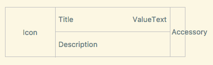

# AiForms.SettingsView for .NET MAUI

SettingViewは.NET MAUIで使用できる設定に特化した柔軟なTableViewです。  
AndroidとiOSに対応しています。

> [!IMPORTANT]
> **後継ライブラリ [KsSettingsView](https://github.com/kamusoft/KsSettingsView) を公開しました。**
>
> KsSettingsViewは、iOS、Android、.NET MAUIでリスト形式の設定画面を構築するためのライブラリで、両platformでNative描画を行います。.NET MAUIでは [`KsSettingsView.Maui`](https://www.nuget.org/packages/KsSettingsView.Maui/) パッケージを導入してください。
> 今後の開発はKsSettingsViewで行うため、このライブラリの更新は予定していません。新規プロジェクトではKsSettingsViewの利用をおすすめします。既存の設定画面を移行する場合は [AiForms.Maui.SettingsViewからの移行ガイド](https://github.com/kamusoft/KsSettingsView/blob/main/skills/ja/kssettingsview-aiforms-migration/SKILL.md) を参照してください。


## SettingsViewでできること（標準のTableViewとの違い）

### 全般

* Separatorの色の設定
* 選択された時の色の指定
* リストの先頭・最後へのスクロール

### セクション

* セクションごとの表示・非表示の設定
* セクションのフッターの設定
* ヘッダーとフッターの様々な設定
* ヘッダーとフッターにFormsのViewを設定
* セクション内にDataTemplateおよびDataTemplateSelectorを適用
* セクション内でドラッグドラッグによる並べ替え

### Cells

* すべてのセルの外観などをSettingsViewで一括で指定
* 個別のセルの設定（個別の設定は全体の設定より優先されます）
* Cell右上にヒントテキストの設定
* 全てのセルでのアイコン設定、それらすべてにメモリキャッシュを適用
* アイコンの角丸設定
* 様々な定義済みCellの使用
* Xamarin.FormsのViewCell、それ以外の定義済みCellの使用


 

### デモ動画

[https://youtu.be/FTMOqNILxBE](https://youtu.be/FTMOqNILxBE)

## 最小デバイス・バージョン等

iOS13  
Android8.0

## インストール

[https://www.nuget.org/packages/AiForms.Maui.SettingsView/](https://www.nuget.org/packages/AiForms.Maui.SettingsView/)

```bash
Install-Package AiForms.Maui.SettingsView
```


```cs
public static MauiApp CreateMauiApp()
{
    var builder = MauiApp.CreateBuilder();
    builder
        .UseMauiApp<App>()                    
        .ConfigureMauiHandlers(handlers =>
        {
            handlers.AddSettingsViewHandler(); // write this
        });
    ...
}
```


## Xamlでの使用方法

```xml
<ContentPage 
	xmlns="http://xamarin.com/schemas/2014/forms" 
	xmlns:x="http://schemas.microsoft.com/winfx/2009/xaml" 
	xmlns:sv="clr-namespace:AiForms.Settings;assembly=SettingsView"
	x:Class="Sample.Views.SettingsViewPage">
    
<sv:SettingsView HasUnevenRows="true">
    
    <sv:Section Title="Header1" FooterText="Footer1">
        <sv:CommandCell IconSource="icon.png" IconSize="60,60" IconRadius="30"
            Title="Xam Xamarin" Description="hoge@fuga.com"
            Command="{Binding ToProfileCommand}" CommandParameter="{Binding Parameter}"
            KeepSelectedUntilBack="true"            
        />
        <sv:ButtonCell Title="Toggle Section" TitleColor="{StaticResource TitleTextColor}"
             TitleAlignment="Center" Command="{Binding SectionToggleCommand}" />
        <sv:LabelCell Title="Label" ValueText="value" />
        <sv:SwitchCell Title="Switch" On="true" 
            Description="This is description." />
        <sv:CheckboxCell Title="Checkbox" Checked="true" />
    </sv:Section>

    <sv:Section Title="Header2" FooterText="Footer2" IsVisible="{Binding SctionIsVisible}">
        <sv:PickerCell Title="Favorites" ItemsSource="{Binding ItemsSource}" DisplayMember="Name" MaxSelectedNumber="3" 
        SelectedItems="{Binding SelectedItems}" KeepSelectedUntilBack="true" PageTitle="select 3 items" />
        <sv:NumberPickerCell Title="NumberPicker" Min="0" Max="99" Number="15" PickerTitle="Select number" />
        <sv:TimePickerCell Title="TimePicker" Format="HH:mm" Time="15:30" PickerTitle="Select time" />
        <sv:DatePickerCell Title="DatePicker" Format="yyyy/MM/dd (ddd)" Date="2017/11/11" MinimumDate="2015/1/1" MaximumDate="2018/12/15" TodayText="Today's date"/>
        <sv:EntryCell Title="EntryCell" ValueText="{Binding InputText.Value}" Placeholder="Input text" Keyboard="Email" TextAlignment="End" HintText="{Binding InputError.Value}" />
    </sv:Section>
    
</sv:SettingsView>
</ContentPage>
```
SettingsViewのプロパティ設定はApp.xamlに記述した方が良いかもしれません。


```xml
<Application xmlns="http://xamarin.com/schemas/2014/forms"
             xmlns:x="http://schemas.microsoft.com/winfx/2009/xaml"
             xmlns:sv="clr-namespace:AiForms.Settings;assembly=SettingsView"
             x:Class="Sample.App">
    <Application.Resources>
        <ResourceDictionary>
            <Color x:Key="AccentColor">#FFBF00</Color>
            <Color x:Key="DisabledColor">#E6DAB9</Color>
            <Color x:Key="TitleTextColor">#CC9900</Color>
            <Color x:Key="PaleBackColorPrimary">#F2EFE6</Color>
            <Color x:Key="PaleBackColorSecondary">#F2EDDA</Color>
            <Color x:Key="DeepTextColor">#555555</Color>
            <Color x:Key="NormalTextColor">#666666</Color>
            <Color x:Key="PaleTextColor">#999999</Color>
            <x:Double x:Key="BaseFontSize">12</x:Double>
            <x:Double x:Key="BaseFontSize+">14</x:Double>
            <x:Double x:Key="BaseFontSize++">17</x:Double>
            <x:Double x:Key="BaseFontSize-">11</x:Double>

            <Style TargetType="sv:SettingsView">
                <Setter Property="SeparatorColor" Value="{StaticResource DisabledColor}" />
                <Setter Property="BackgroundColor" Value="{StaticResource PaleBackColorPrimary}" />
                <Setter Property="HeaderBackgroundColor" Value="{StaticResource PaleBackColorPrimary}" />
                <Setter Property="CellBackgroundColor" Value="{StaticResource AppBackground}" />
                <Setter Property="CellTitleColor" Value="{StaticResource DeepTextColor}" />
                <Setter Property="CellValueTextColor" Value="{StaticResource NormalTextColor}" />
                <Setter Property="CellTitleFontSize" Value="{StaticResource BaseFontSize++}" />
                <Setter Property="CellValueTextFontSize" Value="{StaticResource BaseFontSize}" />
                <Setter Property="CellDescriptionColor" Value="{StaticResource NormalTextColor}" />
                <Setter Property="CellDescriptionFontSize" Value="{StaticResource BaseFontSize-}" />
                <Setter Property="CellAccentColor" Value="{StaticResource AccentColor}" />
                <Setter Property="SelectedColor" Value="#50FFBF00" />
                <Setter Property="HeaderTextColor" Value="{StaticResource TitleTextColor}" />
                <Setter Property="FooterFontSize" Value="{StaticResource BaseFontSize-}" />
                <Setter Property="FooterTextColor" Value="{StaticResource PaleTextColor}" />
            </Style>
        </ResourceDictionary>
    </Application.Resources>
</Application>

```

こんな感じに書くことでアプリ内の全てのSettingsViewを同じ設定にすることができます。

## SettingsViewのプロパティ

* BackgroundColor
	* View全体と領域外の背景色。ヘッダーやフッターの背景色も含みます。（Androidの場合はCellの背景色も）
* SeparatorColor
    * セパレータの線の色
* SelectedColor
    * 行（セル）を選択した時の背景色（AndroidはRipple色も含む）
    > AndroidのRipple効果はセルの背景色が設定されていない(透明の)場合は発動しません。
* HeaderPadding
* HeaderTextColor
* HeaderFontSize
* HeaderFontFamily
* HeaderFontAttributes
* HeaderTextVerticalAlign
  > HeaderHeightを設定した場合のみ有効です。
* HeaderBackgroundColor
* HeaderHeight
    * ヘッダーに関する設定
* FooterTextColor
* FooterFontSize
* FooterFontFamily
* FooterFontAttributes
* FooterBackgroundColor
* FooterPadding
    * フッターに関する設定
* RowHeight
	* HasUnevenRowがfalseの時は、全行の高さ
	* それ以外は最小の行の高さ
* HasUnevenRows
	* 行の高さを固定にするかどうか。デフォルトはfalse。true推奨。
* CellTitleColor
* CellTitleFontSize
* CellTitleFontFamily
* CellTitleFontAttributes
* CellValueTextColor
* CellValueTextFontSize
* CellValueTextFontFamily
* CellValueTextFontAttributes
* CellDescriptionColor
* CellDescriptionFontSize
* CellDescriptionFontFamily
* CellDescriptionFontAttributes
* CellBackgroundColor
* CellIconSize
* CellIconRadius
* CellAccentColor
* CellHintTextColor
* CellHintFontSize
* CellHintFontFamily
* CellHintFontAttributes
    * 一括セル設定。どこがどのパーツかは後述のLayoutを参照。
* UseDescriptionAsValue (Androidのみ有効)
	* Description項目をValue項目として使用するかどうか。
	* （一般的なAndroidアプリにありがちな設定値を下に書くレイアウトにするかどうか）
	* デフォルトはfalse（DescriptionとValueは個別に使う）
* ShowSectionTopBottomBorder (Androidのみ有効)
	* 行の境界線をセクションの上と下にも表示するかどうか
	* （一般的なAndroidアプリでありがちな上と下は表示しないようにしないかどうか）
	* デフォルトはtrue（表示する）
* ShowArrowIndicatorForAndroid
  * CommandCell や PickerCell で 右端の矢印アイコンを Android でも表示するかどうか
  * デフォルトは false (表示しない)
* ScrollToTop
* ScrollToBottom
	* このプロパティにtrueをセットすると先頭または末尾までスクロールします。
	* スクロール完了後は自動でfalseがセットされます。
* VisibleContentHeight
    * 表示されているコンテンツの高さです。この値を使って SettingsView 自体の高さを表示されているセルの合計の高さに合わせることができます。
* ItemsSource
* ItemTemplate
    * SettingsView全体のDataTemplateを使用できます。SectionのDataTemplateと組み合わせることで単純な構造のセルを短いコードで実現できます。
* TemplateStartIndex
  * Templateの挿入を開始するインデックスを指定。デフォルトは0で最初からTemplateを適用します。1以上の値を指定すると、その位置からTemplateが挿入されるようになり、XAML等で挿入したデータはそのままの状態で残ります。任意の位置から繰り返しのセクションを設置した場合などに利用できます。

### SettingsView の高さを内容の高さに合わせるには

SettingsView の内容のセルの合計の高さが、親のViewよりも低い場合は、次のように HeightRequest と VisibleContentHeight を使って、自身の高さを内容の高さに合わせることができます。

```xml
<sv:SettingsView x:Name="settings" HeightRequest="{Binding VisibleContentHeight,Source={x:Reference settings}}">
</sv:SettingsView>
```

### SetttingsView自身のItemsSourceとItemTemplateの使用例

```csharp
public class SomeViewModel
{
    public List<MenuSection> ItemsSource {get;set;}

    public SomeViewModel()
    {
        ItemsSource = new List<MenuSection>{
            new new MenuSection("Select number",3){
                new MenuItem{Title = "3",Value=3},
                new MenuItem{Title = "4",Value=4},
            },
            new MenuSection("Select mode",1){
                new MenuItem{Title = "A",Value = 1},
                new MenuItem{Title = "B",Value = 2}
            }
        }
    }
}
public class MenuItem
{
    public string Title { get; set; }
    public int Value { get; set; }
}

public class MenuSection:List<MenuItem>
{
    public string SectionTitle { get; set; }
    public bool Selected { get;set; } // must implement INotifyPropertyChanged by some way

    public MenuSection(string title,int initalSelectedValue)
    {
        SectionTitle = title;
    }
}
```

```xml
<sv:SettingsView x:Name="Settings" ItemsSource="{Binding ItemsSource}">
    <sv:SettingsView.ItemTemplate>
        <DataTemplate>
            <sv:Section Title="{Binding SectionTitle}" ItemsSource="{Binding}" sv:RadioCell.SelectedValue="{Binding Selected}">
                <sv:Section.ItemTemplate>
                    <DataTemplate>
                        <sv:RadioCell Title="{Binding Title}" Value="{Binding Value}" />
                    </DataTemplate>
                </sv:Section.ItemTemplate>
            </sv:Section>
        </DataTemplate>
    </sv:SettingsView.ItemTemplate>
</sv:SettingsView>
```

## SettingsViewのメソッド

* ClearCache (static)
	* 全ての画像メモリキャッシュをクリアする

## Section プロパティ

* Title
	* セクションのヘッダー文字列。Xamarin.FormsのTableSectionと同じです。
* FooterText
	* セクションのフッター文字列。
* IsVisible
	* セクションを表示するかどうか。
* HeaderHeight
	* セクションのヘッダーの個別の高さを指定します。
	* SettingsViewのHeaderHeightよりも優先されます。
* ItemsSource
	* DataTemplateのソースを指定します。
* ItemTemplate
	* DataTemplateを指定します。
* TemplateStartIndex
  * Templateの挿入を開始するインデックスを指定。デフォルトは0で最初からTemplateを適用します。1以上の値を指定すると、その位置からTemplateが挿入されるようになり、XAML等で挿入したデータはそのままの状態で残ります。任意の位置から繰り返しの Cell を設置した場合などに利用できます。
* UseDragSort
	* セクション内のセルをDragDropで並べ替え可能にします。
	* UseDragSortがtrueのセクション間でのみ移動が可能です。
	* iOS11以降とそれ以外で外観が異なります。
	* iOS10以下は三本線のアイコンを掴むと移動でき、iOS11はセル全体を長押しすると移動できるようになります。
* HeaderView
* FooterView
  * Header または Footer に Forms の View を指定します。
  > こちらを設定すると Title や FooterText も文字列は無効になります。
  > HeaderView と FooterView を使用するとセルの高さは自動になります。
* FooterVisible
  * FooterViewの表示・非表示を指定します。default true。

### Section HeaderView FooterView XAMLからの使用例

```xml
<sv:Section>
    <sv:Section.HeaderView>
        <StackLayout>
            <Label Text="Header" />
        </StackLayout>
    </sv:Section.HeaderView>
    <sv:Section.FooterView>
        <Label Text="{Binding FooterText}" />
    </sv:Section.FooterView>
</sv:Section>
```

### SectionのItemsSourceとItemTemplateの使用例

```csharp
public class SomeModel
{
   // 動的なリストを使う場合はObservableCollectionを使った方が良いです。
   public ObservableCollection<Option> Options {get;set;}
   public void SomeMethod()
   {
       Options = new ObservableCollection(GetServerData());
   }
}
public class Option
{
   public string Name {get;set;}
   public string Address {get;set;}
}
```

```xml
<sv:Section ItemsSource="{Binding Options}">
    <sv:Section.ItemTemplate>
        <DataTemplate>
            <sv:LabelCell Title="{Binding Name}" Value="{Binding Address}" />
        </DataTemplate>
    </sv:Section.ItemTemplate>
</sv:Section>
```

## Cells

* [CellBase](#cellbase)
* [LabelCell](#labelcell)
* [CommandCell](#commandcell)
* [ButtonCell](#buttoncell)
* [SwitchCell](#switchcell)
* [CheckboxCell](#checkboxcell)
* [RadioCell](#radiocell)
* [NumberPickerCell](#numberpickercell)
* [TimePickerCell](#timepickercell)
* [DatePickerCell](#datepickercell)
* [TextPickerCell](#textpickercell)
* [PickerCell](#pickercell)
* [EntryCell](#entrycell)
* [CustomCell](#customcell)

## CellBase

### 基本セルのレイアウト



* Icon
    * アイコンを使わない場合はこの領域は非表示になります。
* Description
    * Descriptionを使わない場合はこの領域は非表示になります。
* Accessory
    * CheckboxCellやSwitchCellで使用されます。それ以外は非表示です。

### プロパティ (全セル共通)

* Title
    * Title部分の文字列
* TitleColor
    * Title部分の文字色
* TitleFontSize
* TitleFontFamily
* TitleFontAttributes
    * Title部分のフォント設定
* Description
    * Description部分の文字列
* DescriptionColor
    * Description部分の文字色
* DescriptionFontSize
* DescriptionFontFamily
* DescriptionFontAttributes
    * Description部分のフォント設定
* HintText
    * Hint部分の文字列（何らかの情報やバリデーションのエラーなど、右上に表示）
* HintTextColor
    * Hint部分の文字色
* HintFontSize
* HintFontFamily
* HintFontAttributes
    * Hint部分のフォント設定
* BackgroundColor
    * セルの背景色
* IconSource
    * アイコンのImageSource
* IconSize
    * アイコンサイズ（幅,高さ指定）
* IconRadius
    * アイコンの角丸半径。
* IsEnabled
  * セルを有効にするかどうか。無効にした場合はセル全体の色が薄くなり操作を受け付けなくなります。
* IsVisible
  * セルの表示・非表示

### メソッド

* Reload
  * セルを強制的にリロードします。CustomCell等で動的に内容を変更した後などに使用します。

### SVGイメージを使用するには

SvgImageSourceのnugetパッケージをインストールすればSVG画像を使用できるようになります。

https://github.com/muak/SvgImageSource  
https://www.nuget.org/packages/Xamarin.Forms.Svg/

```bash
Install-Package Xamain.Forms.Svg -pre
```

## LabelCell

テキスト表示専用のセルです。

### Properties

* ValueText
    * 何らかの値を示す文字列（何に使っても問題ありません）
* ValueTextColor
    * ValueText部分の文字色
* ValueTextFontSize
* ValueTextFontFamily
* ValueTextFontAttributes
    * ValueText部分のフォント設定
* IgnoreUseDescriptionAsValue
	* UseDescriptionAsValueの値がtrueだった場合、その設定を無視するかどうか。
	* 例えば全体としてはValueは下に置きたいが、あるセルだけは通常のレイアウトで使用したい時などに使います。

## CommandCell

タップした時のコマンドを指定できるLabelCellです。
例えばページ遷移の時などに使用します。

### Properties

* Command
* CommandParameter
* KeepSelectedUntilBack
	* タップして次のページに遷移した時、遷移先ページから戻ってくるまで選択状態をそのままにしておくかの設定
	* trueの場合は選択状態をキープして、falseの場合は選択はすぐに解除されます。
* HideArrowIndicator
  * 右端の矢印アイコンを非表示にします。
  * 親のShowArrowIndicatorForAndroidがtrueの場合でもこちらのプロパティが優先されます。

他はLabelCellと同じです。

## ButtonCell

ボタンのようにタップするとコマンドを実行するだけのシンプルなセルです。
CommandCellとの違いは以下のとおりです。
* 右端にインジケーターが表示されない(iOS)
* ValueやDescriptioが使用不可
* ButtonCellは文字の水平位置を指定可能

### Properties

* TitleAlignment
    * ボタンタイトルの水平位置属性
* Command
* CommandParameter


## SwitchCell

Switchを備えたLabelCellです。

### Properties

* On
    * Switchのオンオフ。OnがtrueでOffがfalse。 
* AccentColor
    * Switchのアクセントカラー。背景色やつまみ部分の色などプラットフォームによって異なる。

## CheckboxCell

Checkboxを備えたLabelCellです。

### Properties

* Checked
    * Checkのオンオフ。OnがtrueでOffがfalse。
* AccentColor
    * Checkboxのアクセントカラー。（枠や背景色） 

## RadioCell

セクション単位またはSettingsView全体で1つのアイテムを選択するCellです。PickerCellと違い選択項目を1階層目に配置する場合などに使用します。

### Properties

* Value
    * セルに対応する選択候補値。
* AccentColor
    * チェックマークの色。

### 添付プロパティ

* SelectedValue
    * 現在の選択値。
    * このプロパティをSectionに設定した場合は、そのSectionから1つだけ選択できるようになり、SettingsView自体に設定した場合は、View全体から1つだけ選択できるようになります。
    > SectionとSettingsViewの両方に設定して動作させることはできません。両方に設定した場合はSection側が使用されます。

### XAML サンプル

#### セクション単位

```xml
<sv:SettingsView>
    <sv:Section Title="Sound" sv:RadioCell.SelectedValue="{Binding SelectedItem}">
        <sv:RadioCell Title="Sound1" Value="{Binding Items[0]}">
        <sv:RadioCell Title="Sound2" Value="{Binding Items[1]}">
    </sv:Section>
</sv:SettingsView>
```

#### コントロール全体

```xml
<sv:SettingsView sv:RadioCell.SelectedValue="{Binding GlobalSelectedItem}">
    <sv:Section Title="Effect">
        <sv:RadioCell Title="Sound1" Value="{Binding Items[0]}">
        <sv:RadioCell Title="Sound2" Value="{Binding Items[1]}">
    </sv:Section>
    <sv:Section Title="Melody">
        <sv:RadioCell Title="Melody1" Value="{Binding Items[2]}">
        <sv:RadioCell Title="Melody2" Value="{Binding Items[3]}">
    </sv:Section>
</sv:SettingsView>
```

## NumberPickerCell

セルタップ時にNumberPickerを呼び出すことができるLabelCellです。

### Properties

* Number
    * 現在の数値（default two way binding)
* Min
    * 最小値
* Max
    * 最大値
* PickerTitle
    * Pikerのタイトル文字列
* SelectedCommand
    * 数値を選択した時に発火させるCommand。
* Unit
  * 数値の単位文字列。

ValueTextは使用できません。

## TimePickerCell

セルタップ時にTimePickerを呼び出すことができるLabelCellです。

### Properties

* Time
    * 現在選択中の時刻 (default two way binding)
* Format
    * 時刻の書式 ("hh時mm分"など)
* PickerTitle
    * Pikerのタイトル文字列

ValueTextは使用できません。

## DatePickerCell

セルタップ時にDatePickerを呼び出すことができるLabelCellです。

### Properties

* Date
    * 現在選択中の日付 (default two way binding)
* MinimumDate
* MaximumDate
* Format
    * 日付の書式 ("yyyy年MM月dd日 ddd曜日"など)
* TodayText
	* 今日の日付を選択するためのボタンのタイトル文字列（iOSのみ）
    * 空の場合はボタン自体が非表示になります。
* InitialDate
  * Dateがnullだった場合に、ピッカーの初期値として設定される日付
* IsAndroidSpinnerStyle
  * AndroidでカレンダーではなくスピナーUIを使用する場合にTrue
* AndroidButtonColor
  * Androidのダイアログのボタン文字色

ValueTextは使用できません。

## TextPickerCell

セルタップ時にテキストを選択できるピッカーを呼び出すことができるLabelCellです。
NumberPickerCellをNumber以外に対応させたもので、データソースにListを設定できます。

### Properties

* Items
	* IListを実装したデータソース。
	* このプロパティには組み込みの型のList\<T>等が設定できます。（List\<string>, List\<int>,List\<double> など）
	* ピッカーの表示テキストにはToString()の結果が使用されます。
* SelectedItem
	* 選択したアイテム。 (two-way binding)
* SelectedCommand
    * アイテム選択時に発火するコマンド。
* IsCircularPicker
    * ピッカーのアイテムを循環させるかどうか。(Android のみ)
    * デフォルト true

ValueTextは使用できません。

## PickerCell

セルタップ時に複数選択可能なピッカーを呼び出すことができるLabelCellです。
iOSではタップ時にページ遷移し遷移先ページでピッカーが表示されます。
Androidではタップ時にダイアログでピッカーが表示されます。

### Properties

* PageTitle
    * ピッカーのタイトル文字列
* ItemsSource
    * IEnumerableを実装したPickerのDataSource（List<T>やObservableCollection<T>など）
    * nullを指定することはできません。
* DisplayMember
    * Pickerに選択肢として表示させるメンバー名（プロパティ名）。省略時はToStringの値が使用されます。
* SubDisplayMember
	* Pickerに表示させる二番目のメンバー名（プロパティ名）。指定するとセルは2行表示となり、1行目にDisplayMemberが、2行目にSubDisplayMemberが表示されるようになります。
* SelectionMode
  * 複数選択か単一選択かのモードを Single / Multiple から選択。デフォルト Multiple。
* SelectedItem
  * 単一選択の場合の選択されたアイテム。
* SelectedItems
  * 複数選択の場合の選択されたアイテム。
  * 選択したItemを保存するためのIList。ItemsSourceと同じ型のものを指定。
  * 選択済み要素をあらかじめ設定する場合は、ItemsSourceの要素と同一インスタンスの要素にする必要があります。
  * 指定する場合は必ずnullではなくインスタンス設定済みのものを指定する。
* SelectedItemsOrderKey
	* 選択済みItemを文字列として表示する時のソートのキーとなるメンバー（プロパティ）名
* SelectedCommand
	* 選択が完了した時に発火するコマンド
	* iOSの場合はピッカーページから戻る時、Androidの場合はダイアログのOKをタップした時に発火します。
* MaxSelectedNumber
    * 選択可能な最大数。
	* 0指定で無制限、1指定で単一選択モード（ラジオボタン的なやつ）、2以上は制限付きの複数選択となります。
* KeepSelectedUntilBack
	* タップして次のページに遷移した時またはダイアログ表示時、戻ってくるまで選択状態をそのままにしておくかの設定
	* trueの場合は選択状態をキープして、falseの場合は選択はすぐに解除されます。
* AccentColor
    * Pickerのチェックマークの色
* UseNaturalSort
	* 並べ替え方法にNaturalSortを使うかどうか。デフォルト false。
	* trueの場合、例えば通常 1,10,2,3,4 と並ぶところが 1,2,3,4,10 という並びになります。
	* 日本語以外の言語で使用する場合、誤動作する可能性があります。
* UsePickToClose
	* 選択がMaxSelectedNumberに達したら自動的にPickerを閉じるかどうかを指定します。
* UseAutoValueText
	* 通常は選択アイテムが自動でValueTextに表示されますが、このプロパティにfalseを指定すると自動表示が解除され、ValueTextを普通に使うことができるようになります。


## EntryCell

文字入力用のCellです。
Xamarin.Forms.EntryCellとは別物です。

### Properties

* ValueText
    * 入力文字列 (default two way binding)
* ValueTextColor
    * 入力文字色
* ValueTextFontSize
* ValueTextFontFamily
* ValueTextFontAttributes
    * 入力文字列のフォント設定
* MaxLength
    * 最大文字列長
* Keyboard
    * キーボードの種類
* Placeholder
    * Placeholderの文字列
* PlaceholderColor
    * Placeholderの文字色
* TextAlignment
    * 入力文字列の水平位置属性
* AccentColor
    * 入力欄の下線の色（Androidのみ）
* IsPassword
    * パスワードなどのために入力文字を隠すかどうか。
* CompletedCommand
  * エンターによる文字入力の確定、またはフォーカス移動による確定時に発火するコマンド。

### Methods

* SetFocus
  * フォーカスを設定します。

## CustomCell

真ん中の Title / ValueText / Description の部分を Forms View で自由に設定できるCellです。View部分はXAMLで指定することができます。
基本的には CustomCell のサブクラスを作成し、それを利用する形で使用されることを想定しています。

## Properties

* ShowArrowIndicator
  * セルの右端に矢印インジケータを表示するかどうか。
  * true で iOS / Android に関わらず矢印を表示します。
* IsSelectable
  * 行を選択可能かどうか。true で Commandが発火するようになります。
* IsMeasureOnce
  * サイズ計算を1回だけ行うかどうか。デフォルト false。
  * 高さが内容によって変わらないような場合にサイズ計算を省略することができます。
* UseFullSize
  * true で自由領域を範囲を余白なしで目一杯使うようにします。
  > 有効にした場合、アイコンの設定は無効になります。
* Command
* CommandParameter
* LongCommand
  * 長押し時に発火するコマンド
* KeepSelectedUntilBack
	* タップして次のページに遷移した時、遷移先ページから戻ってくるまで選択状態をそのままにしておくかの設定
	* trueの場合は選択状態をキープして、falseの場合は選択はすぐに解除されます。

### CustomCellの使用例

* https://github.com/muak/AiForms.SettingsView/tree/development/Sample/Sample/Views/Cells
* https://github.com/muak/AiForms.SettingsView/blob/development/Sample/Sample/Views/CustomCellTest.xaml

## Contribution

私たちは、Xamarin.Forms.GoogleMaps への、あなたの貢献に大変感謝します。
開発に参加して頂ける方は、[コントリビューション ガイドライン](CONTRIBUTING-ja.md) を読んで下さい。

## Contributors

* [codegrue](https://github.com/codegrue)
* [cpraehaus](https://github.com/cpraehaus)
* [dylanberry](https://github.com/dylanberry)
* [RLittlesll](https://github.com/RLittlesII)
* [ChaseFlorell](https://github.com/ChaseFlorell)
* [OnTheFenceDevelopment](https://github.com/OnTheFenceDevelopment)
* [SiNeumann](https://github.com/SiNeumann)
* [akaegi](https://github.com/akaegi)


## 謝辞

NaturalSortの実装に以下のソースを利用させていただきました。
ありがとうございました。

* NaturalComparer
	* https://qiita.com/tomochan154/items/1a3048f2cd9755233b4f
    * https://github.com/tomochan154/toy-box/blob/master/NaturalComparer.cs

## 寄付

開発継続のため、寄付を募集しています。

寄付をいただけるとやる気が非常にアップしますので、どうかよろしくお願いいたします🙇

* [PayPalMe](https://paypal.me/kamusoftJP?locale.x=ja_JP)

## スポンサー

スポンサーも募集しています。
こちらはサブスクリプション制になります。

* [GitHub Sponsors](https://github.com/sponsors/muak)


## License

MIT Licensed.

Some code is taken from [.NET MAUI](https://github.com/dotnet/maui).

[Material design icons](https://github.com/google/material-design-icons) - [Apache License Version 2.0](https://www.apache.org/licenses/LICENSE-2.0.txt)